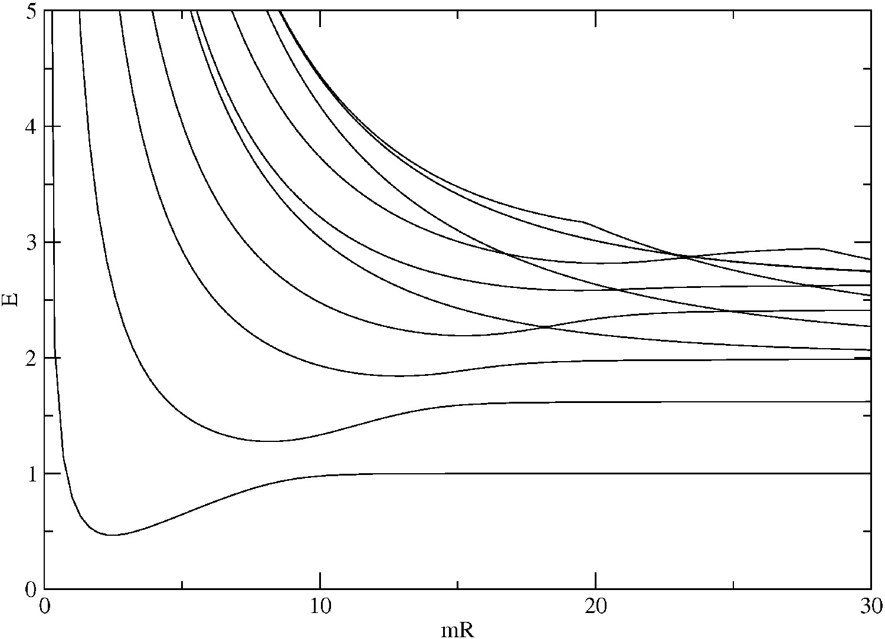
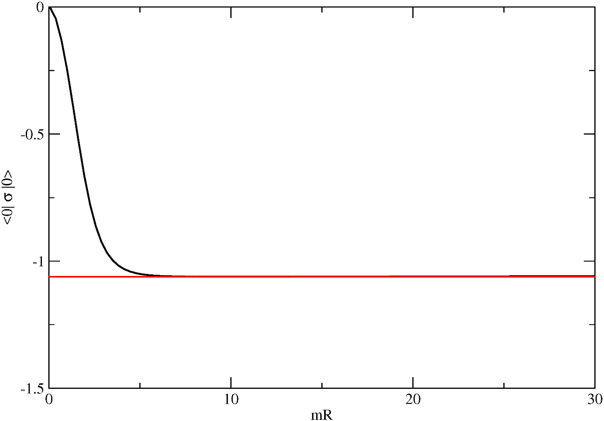
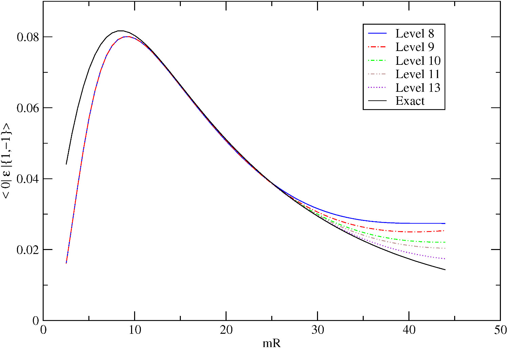

TruSpace 2.0
============

.. contents::  

Introduction
-------------

TruSpace is Truncated Space Approach (``TSA``) code featuring spectrum-based Numerical Renormalization Group (``NRG``) [1]_ and its extension, that we call ``Sweep`` [2]_.

The goal of ``TSA`` is to calculate the spectrum and possibly expectation values of a system described by an Hamiltonian in the form

H = H\ :sub:`0`\ + H\ :sub:`P`

where H\ :sub:`0`\ is theory of which we are able to calculate the spectrum and expectation values of at the perturbing operator H\ :sub:`P`\. 
Given the eigenstates of the H\ :sub:`0`, | E\ :sup:`0` :sub:`i`\>, the matrix form of the pertubed Hamiltonian can be written as 

<E\ :sup:`0`:sub:`i`\| H | E\ :sup:`0`:sub:`j`\ > = E\ :sup:`0`:sub:`i` |delta|\ :sub:`ij`\   + <E\ :sup:`0`:sub:`i`\| H\ :sub:`P`\ | E\ :sup:`0`:sub:`j`\ > 

If we are able to calculate the last expectation value above, we can then choose a finite number of states up to a certain i  | E\ :sup:`0` :sub:`i`\> and diagonalize numerically the matrix obtained. 

However, diagonalization of the entire matrix can in some cases become cumbersome, in particular in cases in which a large number of states or great precision are required. 

This is were ``NRG`` comes in the game. The idea of spectrum-based ``NRG`` is to take into account the contribution of higher and higher unperturbed states to the complete Hamiltonian low-lying energy states.
This is done by fixing a size M of the matrix to a given value. The size M is splitted in two parts, N and D. The first iteration of the algorithm takes the lowest N+D=M states and performs the usual ``TSA`` procedure. At the second iteration, the last D states are removed, and the following D states of the computational basis are put in the computation and the ``TSA`` procedure is applied on this mixed basis ( N states are approximation of the perturbed theory, while the new D states are unperturbed). The procedure is repeated untill a sufficiently high number of states is included (typically by checking convergence of relevant quantities).  In this way, the total size of the matrix is fixed, but the code is able to get contribution from an increasing number of unpertubed states. 
The typically size of N and D are 2-4000 for N and N/4 for D, while the ``NRG`` is run to include up to tens of thousands of unperturbed states. 

To increase precision even further, we can apply a technique called ``Sweep``. The idea is that, once the ``NRG`` iterations are done, we can start over, but this time instead of using the unperturbed states as computational basis for the D states added at each iteration, we can use the D states discarded at the previous ``NRG`` run at the same iteration. This procedure can be repeated indefinitely, untill convergence is reached. Experimentally, we observerd that 3-4 sweeps are enough to reach convergence in most of the cases. 

The publicly available version supports currently only pertubation of unitary minimal conformal field theories, but it has been applied by the authors and coworkers to other class of models like SU(2)\ :sub:`1`\ [3]_ and 1+1 dimesional Landau-Ginzburg theories [4]_. The plan is to include those two application in TruSpace.

To allow further extension, the ``NRG`` and ``Sweep``

Features
~~~~~~~~

At the present time is able to calculate

- Eigenvalues and Eigenvectors of any unitary perturbed conformal field theory based minimal models ( diagonal partition function only for the moment) using full diagonalization, ``NRG`` or ``Sweep``
- Automatic separation of symmetry subspaces in the perturbed system. Symmetry subspaces are diagonalized separately, to reduce computational complexity
- Possibility of considering non-zero momentum states. Momentum subspace are diagonalized separately ( unless it is specifically requested to diagonalize all the subspaces together). 
- Expectation value on the final basis of any primary field ( descendant field expectation values available but in beta testing phase )

Here are some examples of the results produced by TruSpace 

    Energy levels for M\ :sub:`34`\  + |sigma|

    Vacuum expectation value for operator |sigma| in M\ :sub:`34`\  + |sigma|
    The red line is the analytical result.

    <0| |epsilon| | {1,-1}> in M\ :sub:`45`\  + |epsilon|

Code design
~~~~~~~~~~~~

TruSpace is written in C++ using and Object Oriented design pattern. 

The available classes are

- minimal_model_parameters : class that handles the input reading, the calculation of the structure constants and the analysis of symmetry subspaces.
- worker : class that takes care of running the different parts of the code after all parameters are set 
- minimal_model_states : class that calculates and holds all the informations regarding the computation basis
- chirME : class that calculates and holds all the information about matrix element of the fields on the computational basis 
- minimal_model_filenames : helper class to manage output and swap files names 
- minimal_model_Hamiltonian : class that handles the computation and the matrix form of the TSA Hamiltonian of the perturbed model
- diag : helper class that contains Numerical Recipies diagonalization routines for long double (required to calculate the conformal computational basis)
- tensors : helper template class to handle 2D, 3D, 4D, 5D and 6D tensors. It ensures memory contiguity and automatic deallocation when out of scope, without forcing compilation-time sizes. 
- NRG : model-agnostic  full diagonalization, ``NRG`` and ``Sweep`` routine 

The model-agnostic nature of the NRG class should allow easy extension of the current code to other Quantum Hamiltonians.

Full class documentation available at https://gbrandino.bitbucket.io/truspace/

Building TruSpace
-------------------

Pre-requisites
~~~~~~~~~~~~~~~

If you want to install TruSpace dependecies by yourself, here is the list

- Lapack
- Blas ( we suggest multi-threaded BLAS like Intel MKL_ or OpenBLAS)  
- Ginac_ and its dependecy CLN_
- MPI implementation (OpenMPI recommmended) for MPI parallel version
   
Otherwise TruSpace comes with a version of the above libraries, so you can simply move to the next section and use the installation script. 

Build instruction - script
~~~~~~~~~~~~~~~~~~~~~~~~~~~

If you want to use the provided script you can simply run the ``install.sh`` in the root folder. This will install all the dependecies in the TruSpace folder and create the executable accordingly. 

(Experimental: you can define your compiler by issuing, for example::

  CC=icc CXX=icpc ./install.sh

:NOTE: Some version of the intel compiler seems to have issues with the c++11 standard. This will cause Ginac to fail compilation.

To remove the compiled code and its dependecies, run ``uninstall.sh``

MPI Build instrction - script 
~~~~~~~~~~~~~~~~~~~~~~~~~~~~~~

Truspace is distributed with a Netlib scalapack implementation, working on top of the provided Openblas

If you want to use the provided script you can simply run the ``install-mpi.sh`` in the root folder. This will install all the dependecies in the TruSpace folder and create the executable accordingly.

Build instruction - local dependencies
~~~~~~~~~~~~~~~~~~~~~~~~~~~~~~~~~~~~~~~

If you want to install the library in a different folder or use verion already available on your system, simply edit the following lines in the ``src/Makefile`` ::

  CXX=                          --> name of the compiler to use
  CLN=                          --> the root folder of the CLN installation (should contain include/ and lib/ subdirs)
  GINAC=                        --> the root folder of the GINAC installation (should contain include/ and lib/ subdirs)
  BLAS=                         --> the root folder of the BLAS installation (should contain include/ and lib/ subdirs). 
  BLAS_LIB=                     --> the name of the BLAS library, for example -lopenblas, -lcblas, -lmkl
  LAPACK_LIB=                   --> should be in the format -L{folder containing lapack library files} -l{library name}
  (SCALAPACK_LIB=)              --> For MPI version only, should point to the static library file libscalapack.a with its full path
 
Then simply issue::

  make -j4

for the serial and OpenMP version, or::

  make -j4 mpi

for the MPI parallel verion.

:NOTE: CMake building will come soon

Running TruSpace
------------------

If you are using multi-threaded BLAS (like the provided OpenBLAS), all linear algebra will be parallel. To this end we 
recommend setting the environment variable OMP_NUM_THREADS to the number of cores of your CPU. 

The code uses two input files: one with model-specific parameters and one for NRG-only parameters. 
To run the code:: 

  export OMP_NUM_THREADS=4
  ./truespace.x input-model input-nrg

THE ORDER OF THE LINES AND THEIR POSITIONS IS FIXED AND CANNOT BE MODIFIED. The are example of input files in the ``examples`` folder

The model input file for minimal_model should be self explanatory::

  3    p
  4    q
  1    number of perturbations
  5    Maximum conformal level to include
  0    Minimum conformal level to include
  0    momentum subpsace considered
  2    index of first perturbation (as indexed in input data file)
  0.09  constant for first perturbation
  1   number of values of R
  0.6  increment at each R step
  8.0  starting value of R
  1    set 1 for complete TCSA calculation, 0 to have just Kac table structure constants and subspace analysis
  0    set 1 to save states to file, 0 not to save them
  0    set 1 to read saved state from file, 0 to calculate them
  0    set 1 to save chiral matrix element to file, 0 not to save them
  0    set 1 to read saved matrix elements from file, 0 to calculate them
  2    index of the operator to calculate matrix elements
  ising-fields.dat     filename of fields file
  ising-constants.dat  filename of the structure constants file

The list of fields to be used are detailed in the "filename of fields file" whose structure is (e.g. Ising case) ::

  1,1,1,1 # 1 - I
  1,2,1,2 # 2 - sigma
  1,3,1,3 # 3 - epsilon
 
where the first two values are the r and s index of the chiral component of the field, while the third and the fourth are the 
r and s index of the anti-chiral component. Everythin after the "#" is a comment. For example, we wrote there the indexing (that always starts from 1)
and the name of the fields. This allows the calcualtion on non-diagonal partition functions. For example, for non-diagonal Potts the file looks like::

  1,1,1,1 # 1 - I
  1,3,1,3 # 2 - omega_+
  1,3,1,3 # 3 - omega_-
  1,5,1,1 # 4 - W
  1,1,1,5 # 5 - bar{W}
  2,5,2,5 # 6 - X
  2,1,2,1 # 7 - epsilon
  2,3,2,3 # 8 - sigma_+
  2,3,2,3 # 9 - sigma_-
  2,5,2,1 # 10 - J
  2,1,2,5 # 11 - bar{J}
  1,5,1,5 # 12 - Y

The structure constants file instead looks like::

  1,2,2|1
  2,2,1|1
  2,2,3|0.5
  3,2,2|0.5

The structure constants are non-chiral, meanining they are the combination of chiral and anti-chiral components. The three indexes referes to the indexing in the fields file,
such that 1,2,2 means the structure constant I,sigma,sigma.
Everything after the "|" is a comment. Here we wrote the conformal weight of the fields.

Fields and structure constants files can be generated using "fields_and_structure_constants.x" for the diagonal partition function minimal models. 

When approaching a new model, it is best to set the key::

  0    set 1 for complete TCSA calculation, 0 to have just Kac table structure constants and subspace analysis

such that not ``TSA`` is performed, but the size of the Hilbert Space of the given model is calculated, as well as the subspace analysis, and the index r and s can be checked upon the 
printed table. 

If more than one perturbation is need, simply add the two lines about the other pertubations after the first one::

  ..
  5     Maximum number of eigenvalues, eigenvectors and matrix elements printed in output file(s), 0 for all of them
  2     index of first perturbation (as indexed in input data file)
  0.09  constant for first perturbation
  3     index of first perturbation (as indexed in input data file) 
  0.06  constant for second perturbation

The NRG input files instead has the structure::

  5   Maximum nunber of eigenvalues, eigenvectors and matrix elements printed in output file(s), 0 for all of them
  500  number of states in the basic matrix for NRG
  250  number of states added in every NRG step
  0    set 1 for NRG, 0 for complete trucated hamiltonian diagonalization
  0    number of NRG sweep. Set 0 for basic NRG
  0    set to 1 to se save eigenvectors to file
  1    set 1 to calculate matrix element of a particular operartor (specified in the model file)
  1    set to 1 to calculated only diagonal matrix elements (<i|phi|i>), 0 for full matrix elements calculation

Running MPI parallel Truspace
~~~~~~~~~~~~~~~~~~~~~~~~~~~~~~~

The MPI version of Truspace is run by simply issuing:: 

  mpirun -np #number-of-process truspace_mpi.x

:NOTE: In a single node scenario, the multithreaded version will always perform better than the MPI version. Use the MPI version only on multinode machines such as clusters.

Even in the multinode scenario, it is always best to use one MPI process per node and than set OMP_NUM_THREADS to the number of core of each node.
This setup will grant the best performance. This amount to issue::

  export OMP_NUM_THREADS=<your number of cores>
  mpirun -np <your number of nodes> -npernode 1 ./truspace_mpi.x input-model-file input-nrg-file

Output files 
~~~~~~~~~~~~~

The code outputs several files, most of which only optionally. In details 

- Eigenvalues file. Always produced. Contains the Eigenvalues for every given value of R. The number of columns depends upon the key ``Maximum number of eigenvalue``. The columns structure is 
  ::

    NRG_iteration   |  Sweep_iteration | Effective_energy |   R   |  1st eigenvalue | 2nd eigenvalue ....

  Example: ``Eigenvalues_p_3_q_4_minLev_0_maxLev_10_Per_1_2_c_0.09_Subspace_0_Mom_0``

- Last iteration eigenvalues file. Produced only for NRG and NRG+Sweep. Same as above, but prints only last NRG iteration (and last sweep of last NRG iteration for sweeping). Same structure of the above file

  Example: ``FINAL_Eigenvalues_p_3_q_4_minLev_0_maxLev_10_Per_1_2_c_0.09_Subspace_0_Mom_0``

- Eigenvectors file. Produced only if the last key in the input (``set to 1 to se save eigenvectors to file``) is 1, contains the eigenvectors using the conformal computation base, one per row. 
  The number of eigenvectors reported depends on the key ``Maximum number of eigenvalue``. If several R values are asked with N as maximum number of eigenvalue, the first N rows will be for the first R value, the next N for the second R, and so on.  

  In the case of NRG or NRG+Sweep, the eigenvectors are only printed at the very last iteration.

  Example: ``Eigenvectors_p_3_q_4_minLev_0_maxLev_10_Per_1_2_c_0.09_Subspace_0_Mom_0``

- Expectation value file. Produced only if ``set 1 to calculate matrix element of a particular primary operator`` is 1. Contains the expectation value of the given operator on the calculated eigenvectors.  The number of reported expectation values depends on the key ``Maximum number of eigenvalue``. So N max eigenvalue will produce a NxN matrix. If several R values are asked , the first NxN will be for the first R value, the next NxN matrix for the second R, and so on.

  If the key ``set to 1 to calculated only diagonal matrix elements`` will instead print only the <i|phi|i>. The output will contain diagonal eigenvectors expecation values, one per column. Different rows correspond to different values of R.   

  In the case of NRG or NRG+Sweep, the expectation values are only printed at the very last iteration.

  Example : ``ExpVal_Op_phi_1_2_\{bar\}phi_1_2_p_3_q_4_minLev_0_maxLev_10_Per_1_2_c_0.09_Subspace_0_Mom_0``

Developer documentation and extending truspace
~~~~~~~~~~~~~~~~~~~~~~~~~~~~~~~~~~~~~~~~~~~~~~~

Full developer documentation and indications about how to expand truspace are available at https://gbrandino.bitbucket.io/truspace/

Known issues
-------------

- At very high truncation level ( >20), you may a get segfault. To fix this, you need to open the file ``config.h`` and modify the variables::

    MaxPart          ----> Should be larger then the number of partitions of the number indicating the level 
    MaxNumGrade      ----> Should larger than truncation level multplied by 2
 
  If after chainging those values you get a segfault, it may be that your stack size is too small. So first check its size::

    ulimit -s 

  Then increase it::

    ulimit -s 10240 

  or set it to infinity::

    ulimit -s unlimited

  If this happens, please drop us a line brandino@exact-lab.it

.. [1] R. M. Konik and  Y. Adamov, Phys. Rev. Lett. 98 (2007) 147205; 
       R. M. Konik and  Y. Adamov, Phys. Rev. Lett. 102 (2009) 097203.

.. [2] G. P. Brandino, R.M. Konik and G.Mussardo - J. Stat. Mech. (2010) P07013

.. [3] M. Beria, G.P. Brandino, L. Lepori, R. M. Konik, G. Sierra - Nuclear Physics B, 2013

.. [4] A. Coser, M. Beria, G. P. Brandino, R. M. Konik and G. Mussardo J. Stat. Mech. (2014) P12010  

.. |delta| unicode:: 0x3B4 

.. |sigma| unicode:: U+03C3

.. |epsilon| unicode:: U+03F5

.. _OpenBLAS : http://www.openblas.net/

.. _Ginac : http://www.ginac.de/

.. _CLN : http://www.ginac.de/CLN/

.. _MKL : https://software.intel.com/en-us/intel-mkl
